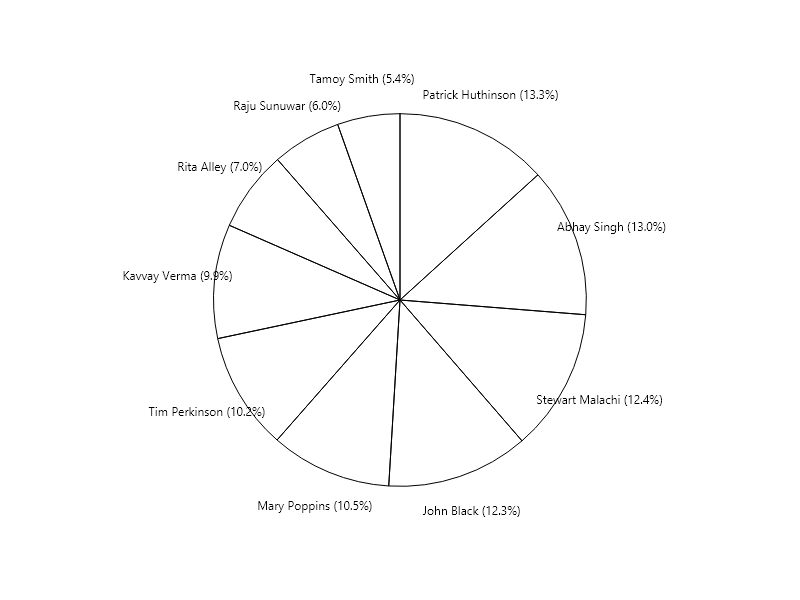

# Sattya_C-Assignment
Part A makes an HTML table of employees sorted by total hours (rows under 100 hours are coloured). Part B makes a pie chart PNG showing each employee's % of total hours.
How to run: download the .exe from Releases, double-click it, and the two output files appear in the same folder. It needs internet.
Data cleaning: skipped entries with no name, deleted entries, and entries where end time is before start time.
Tools: C#, .NET 8, System.Text.Json, LINQ, ScottPlot.
Output: showing the chart with , plus a link to employees.html.
